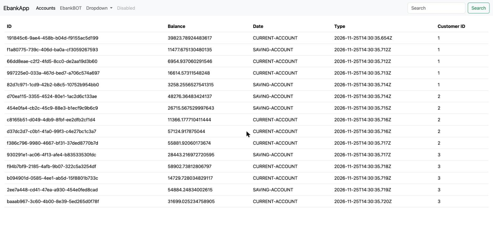
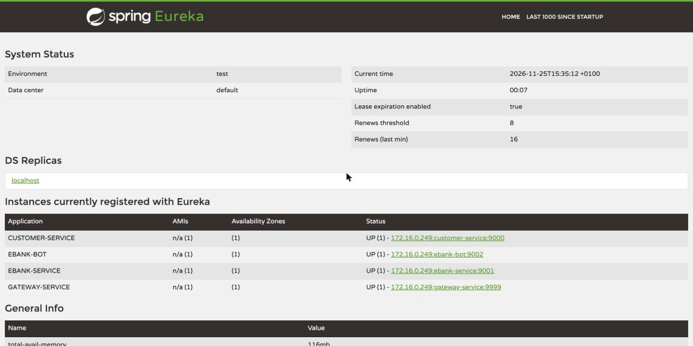
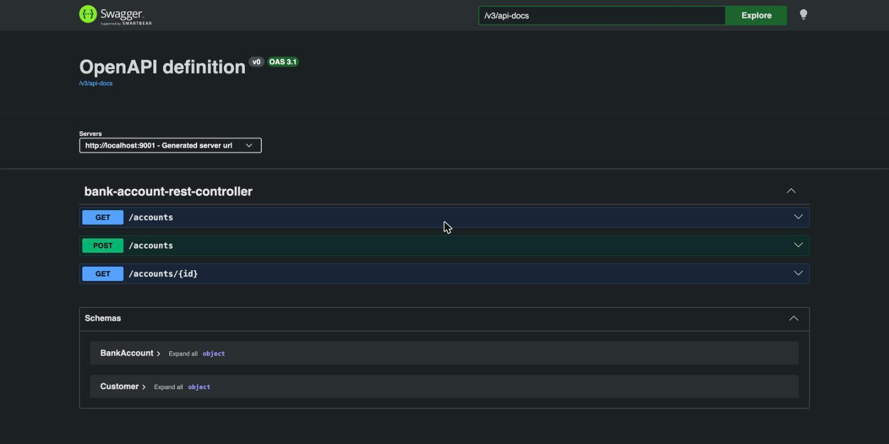
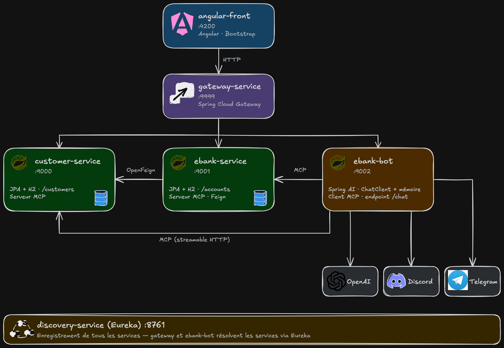

# 🏦 Ebank MS App

Application bancaire basée sur une **architecture microservices** (Spring Boot / Spring Cloud) avec un **front Angular** et un **agent IA** (Spring AI + MCP) capable de répondre en langage naturel à des questions sur les clients et les comptes bancaires, via le web, Discord ou Telegram.

## 📸 Aperçu

| Liste des comptes (Angular) | Réponse de l'agent IA (`/chat`) |
|:--:|:--:|
|  |  |

| Eureka Dashboard | Swagger UI (ebank-service) |
|:--:|:--:|
|  |  |

## 🧩 Architecture



| Module | Port | Rôle |
|---|---|---|
| `discovery-service` | 8761 | Serveur Eureka (service discovery) |
| `gateway-service` | 9999 | Spring Cloud Gateway (CORS ouvert, routage via Eureka) |
| `customer-service` | 9000 | CRUD clients (JPA + H2), expose ses méthodes comme **outils MCP** |
| `ebank-service` | 9001 | CRUD comptes bancaires (JPA + H2), appelle `customer-service` via **OpenFeign**, expose des **outils MCP** |
| `ebank-bot` | 9002 | Agent IA (`ChatClient` + mémoire de conversation + outils MCP), endpoint `/chat`, bots Discord et Telegram |
| `angular-front` | 4200 | Interface web : liste des comptes et chat avec l'agent |

## 🛠️ Stack technique

- **Back-end** : Java 21, Spring Boot 4.1, Spring Cloud 2025.1 (Eureka, Gateway, OpenFeign, Resilience4j), Spring Data JPA, H2, Lombok, springdoc-openapi
- **IA** : Spring AI 2.0 (OpenAI `gpt-4o-mini`), Model Context Protocol (MCP) client/serveur en *streamable HTTP*
- **Front-end** : Angular 22, Bootstrap 5, ngx-markdown (+ KaTeX) pour le rendu des réponses de l'agent
- **Bots** : Discord, Telegram

## ✅ Prérequis

- JDK 21
- Node.js + npm
- Une clé API OpenAI (pour `ebank-bot`)
- (Optionnel) un token Discord et/ou Telegram

## 🚀 Démarrage

Lancer les services dans cet ordre (chacun dans son terminal) :

```bash
# 1. Service discovery
cd discovery-service && ./mvnw spring-boot:run

# 2. Services métier
cd customer-service && ./mvnw spring-boot:run
cd ebank-service    && ./mvnw spring-boot:run

# 3. Gateway
cd gateway-service  && ./mvnw spring-boot:run

# 4. Agent IA (variables d'environnement requises, voir ci-dessous)
cd ebank-bot        && ./mvnw spring-boot:run

# 5. Front Angular
cd angular-front && npm install && npm start
```

### Variables d'environnement de `ebank-bot`

| Variable | Description |
|---|---|
| `OPENAI_API_KEY` | Clé API OpenAI |
| `CUSTOMER_MCP_URL` | URL du serveur MCP de `customer-service` (ex. `http://localhost:9000/mcp`) |
| `EBANK_MCP_URL` | URL du serveur MCP de `ebank-service` (ex. `http://localhost:9001/mcp`) |
| `DISCORD_TOKEN` | Token du bot Discord |
| `TELEGRAM_TOKEN` | Token du bot Telegram |

```bash
export OPENAI_API_KEY=sk-...
export CUSTOMER_MCP_URL=http://localhost:9000/mcp
export EBANK_MCP_URL=http://localhost:9001/mcp
export DISCORD_TOKEN=...
export TELEGRAM_TOKEN=...
```

## 🔗 URLs utiles

| URL | Description |
|---|---|
| http://localhost:4200 | Application Angular (`/accounts`, `/ebank-bot`) |
| http://localhost:8761 | Dashboard Eureka |
| http://localhost:9999/EBANK-SERVICE/accounts | Comptes via la gateway |
| http://localhost:9999/EBANK-BOT/chat?query=Bonjour | Chat avec l'agent via la gateway |
| http://localhost:9000/customers | API clients |
| http://localhost:9001/accounts | API comptes |
| http://localhost:9000/h2-console · http://localhost:9001/h2-console | Consoles H2 |
| http://localhost:9000/swagger-ui.html · http://localhost:9001/swagger-ui.html | Swagger UI |

## 📡 API REST

**customer-service**

| Méthode | Route | Description |
|---|---|---|
| GET | `/customers` | Liste des clients |
| GET | `/customers/{id}` | Client par id |
| POST | `/customers` | Créer un client |

**ebank-service**

| Méthode | Route | Description |
|---|---|---|
| GET | `/accounts` | Liste des comptes |
| GET | `/accounts/{id}` | Compte par id (avec les infos du client) |
| POST | `/accounts` | Créer un compte |

**ebank-bot**

| Méthode | Route | Description |
|---|---|---|
| GET | `/chat?query=...` | Pose une question à l'agent IA |

## 🤖 Agent IA

`EbankAIAgent` utilise un `ChatClient` Spring AI avec :

- un prompt système limitant les réponses au contexte clients / comptes bancaires,
- une mémoire de conversation (`MessageChatMemoryAdvisor`),
- les outils MCP exposés par `customer-service` et `ebank-service` (`@McpTool` : lister, consulter et créer des clients et des comptes).

Le même agent est accessible depuis l'interface web (`/ebank-bot`), Discord et Telegram.

## 🗂️ Données de démonstration

Au démarrage, `customer-service` crée 3 clients (Ahmed, Ali, Mohammed) et `ebank-service` génère 5 comptes par client (`CURRENT-ACCOUNT` ou `SAVING-ACCOUNT`, solde aléatoire). Les bases H2 sont en mémoire : les données sont réinitialisées à chaque redémarrage.

## 👤 Auteur

**Anwar El Ouardini** — [@anwarelouardini](https://github.com/anwarelouardini)
